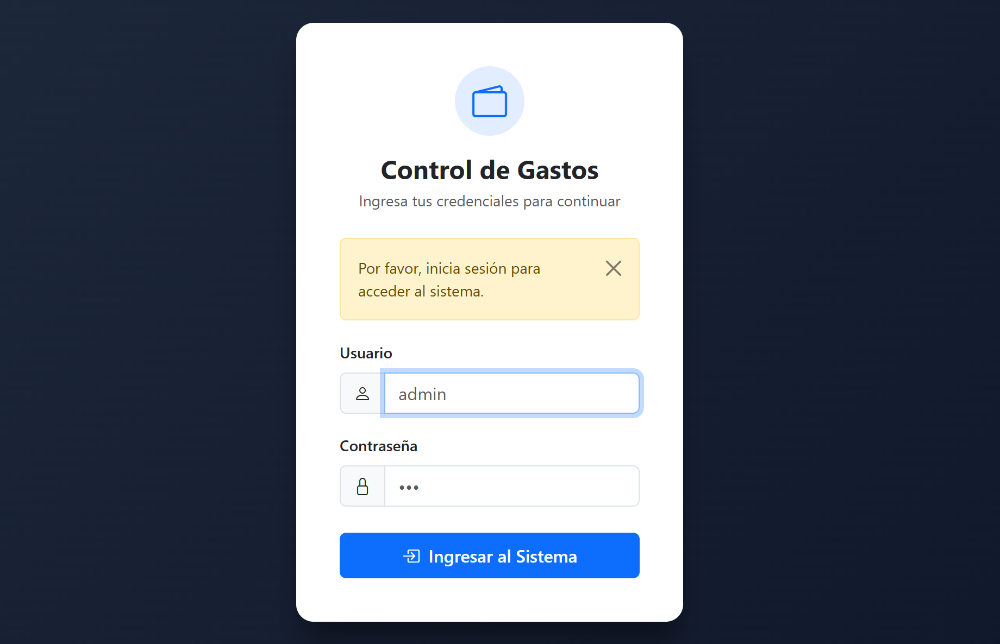
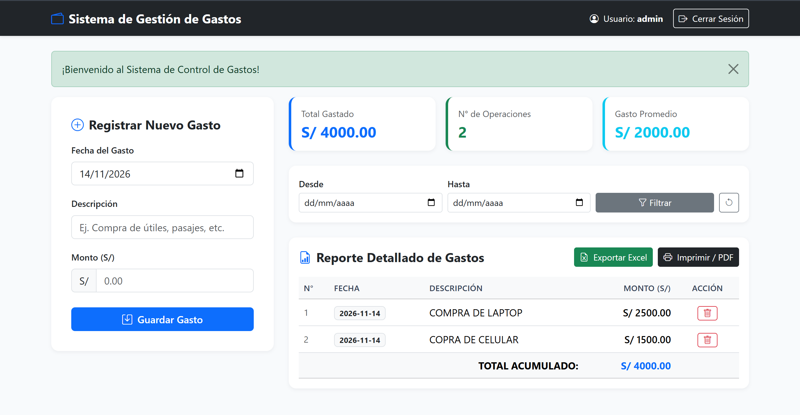
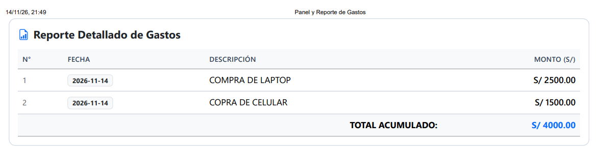

# Sistema Web de Control y Reporte de Gastos

Aplicación web desarrollada con **Python**, **Flask**, **SQLite** y **CSS3 / Bootstrap 5** que permite gestionar el registro de gastos mediante autenticación segura y generación de reportes dinámicos exportables a Excel y PDF.

## Estructura del Proyecto

```text
control-gastos-flask/
├── app.py                   # Backend en Python con Flask, SQLite y exportación Excel
├── requirements.txt         # Dependencias del proyecto (Flask, Werkzeug, OpenPyXL)
├── .gitignore               # Archivos excluidos del control de versiones
├── README.md                # Documentación completa del proyecto
├── static/
│   └── css/
│       └── estilos.css      # Hoja de estilos CSS personalizada (Login, Dashboard e Impresión)
├── templates/
│   ├── login.html           # Interfaz de autenticación de usuario
│   └── dashboard.html       # Panel principal de registro y reporte detallado
└── screenshots/             # Capturas de pantalla del sistema en funcionamiento
    ├── login.png
    ├── dashboard.png
    └── reporte.png
```

## Funcionamiento de la Aplicación

### 1. Control de Acceso (Autenticación)
El sistema cuenta con un módulo de inicio de sesión protegido mediante sesiones de Flask y contraseñas encriptadas (`Werkzeug Security`).
* **Usuario por defecto:** `admin`
* **Clave:** `123`



### 2. Registro de Gastos
Una vez autenticado, el usuario accede al panel principal donde puede registrar nuevos gastos ingresando:
* **Fecha:** Fecha en la que se realizó el gasto.
* **Descripción:** Detalle o concepto del egreso.
* **Monto (S/):** Valor numérico validado en el servidor.



### 3. Reporte Detallado y Exportación (Excel / PDF)
El módulo de reportes procesa las operaciones registradas en SQLite y ofrece:
* **Indicadores (KPIs):** Total gastado, número de operaciones y gasto promedio.
* **Filtro por Rango de Fechas:** Consulta de gastos entre fechas específicas.
* **Exportación a Excel (`.xlsx`):** Genera un libro de Excel formateado con estilos y fórmula dinámica `=SUM(...)`.
* **Impresión / PDF:** Imprime limpiamente únicamente la tabla del **Reporte Detallado de Gastos**.



## Instalación y Ejecución Local

1. Instalar las dependencias:
   ```bash
   py -m pip install -r requirements.txt
   ```

2. Ejecutar la aplicación:
   ```bash
   py app.py
   ```

3. Abrir en el navegador:
   ```text
   http://127.0.0.1:5000
   ```
